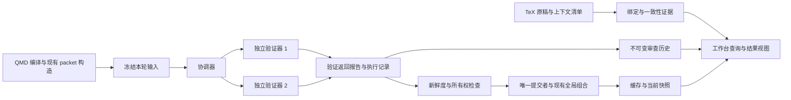

# QMD-Prover 证明审查工作台技术设计

日期：2026-11-07。状态：P0 已在 `feature/workbench-p0` 实现；P1/P2 保持设计阶段。

代码基线：`b4bfbd84c410966d2155ffc2751407eefabcb9f6`，分支 `feature/windows-compat`。
本设计覆盖会话追溯、TeX–QMD 绑定、并行队列、历史比较和任务成本控制五项功能。
采用附加记录和协调层扩展现有引擎，保留数学验证、依赖图和 Shadow Review 的职责边界。
P0 先建立可追溯性；P1 引入受控并行和完整历史；P2 增加任务控制台。
P0 的实际接口以 [workbench 命令指南](../../skills/qmd-prover/references/workbench.md) 为准；
本文中的 run/queue、跨模型比较、成本控制和 `--recheck` 仍为拟议接口。

## 1. 现有实现与设计约束

| 现有能力 | 当前实现 | 对新功能的约束 |
| --- | --- | --- |
| 数学缓存键 | [`verificationKey`](../../skills/qmd-prover/src/core/verification/protocol.ts) 对完整 packet 和 checker contract 求哈希 | 会话 ID、任务 ID、时间、成本、稿件路径不得放入 packet 或 checker contract |
| 局部验证 | [`verifyFacts`](../../skills/qmd-prover/src/core/graph/verify.ts) 按拓扑顺序逐项等待验证器 | 可以并行执行局部检查，不能改变其假设或全局组合规则 |
| 新鲜度检查 | 每次调用后重新编译，并比较 `projectSourceSignature` | 并行结果提交前也必须检查；过期结果不能进入当前决定 |
| 验证缓存 | `verification/checks/<verification-key>.json` 保存 `report`、`outcome` 和 metrics | 缓存是复用入口，不是完整的多轮审查档案 |
| 历史读取 | [`inspect` 的 history](../../skills/qmd-prover/src/commands/inspect/index.ts) 主要筛选顶层 `record.verdict`，当前记录的判定在 `record.report.verdict` | 必须统一兼容读取，不能假设现有历史视图已经覆盖所有记录 |
| 写入工具 | [`atomicWrite`](../../skills/qmd-prover/src/core/infrastructure/files.ts) 原子替换单个文件；`withWriteLock` 当前由 `init` 使用 | `inspect` 缓存、快照和状态投影尚未共用统一写入者；单文件原子替换不等于跨文件事务 |
| 快照发布 | [`publishProjectSnapshot`](../../skills/qmd-prover/src/core/graph/snapshot.ts) 最后更新 `graphs/latest.json` | 将最新指针保留为权威入口，不能让界面拼接不同代的文件 |
| Codex 适配器 | [`codex.ts`](../../skills/qmd-prover/src/verifiers/codex.ts) 当前读取最终文本和 stderr Token 行 | 增加结构化事件解码，继续把判定与执行元数据分开 |
| 页面 | [`render`](../../skills/qmd-prover/src/commands/render/index.ts) 生成 QMD 状态表与依赖图 SVG | 先扩展现有结果视图，避免立即重写成完整网站 |
| Windows | Job supervisor 在本地 AppData 编译，使用原生 argv 和 kill-on-close Job | 并行与取消必须保留进程树清理；打包安装也必须获得所需运行时 |

当前正式数据 Schema 为 8，verifier protocol 为 6。Shadow Review 使用独立实验协议，数学
`outcome` 保持 `inconclusive`。它的准备成功、结构阻断和忠实性判断不能转换为正式数学判定。

### 1.1 必须保持的规则

1. 正式数学状态只由现有机械检查、合法 verifier report 和全局组合得到，不由界面按钮或模型票数得到。
2. 局部检查只接收目标证明、直接依赖陈述、定义和允许的外部基础，不接收依赖证明及其验证状态。
3. 稿件一致性、执行成功与数学正确性分别保存、分别显示。
4. 查看、比较、规划和成本汇总默认不调用模型。运行、继续对话、重试和 AI 一致性审查必须由用户明确触发。
5. 旧的受保护陈述、验证缓存语义和确定性全局组合规则不随工作台功能改变。
6. 不自动重写历史记录、不推测缺失会话 ID、不把未知用量填成零。
7. 源码或上下文变化时保留已产生的调用与成本证据，丢弃不再适用的新决定。

## 2. 总体结构与公共数据模型

工作台增加四个组件：执行记录器、稿件绑定器、单写入者协调器和只读查询层。
验证器仍只负责已有局部条件检查；查询层不拥有授予数学状态的权限。



### 2.1 身份与指纹

| 名称 | 含义 | 是否参与数学缓存键 |
| --- | --- | --- |
| `fact_id` | 项目内稳定的语义 ID | 保持现有规则 |
| `verification_key` | 现有 packet 与 checker contract 的缓存地址 | 本身就是现有键 |
| `packet_hash` | 本次确切提交的 packet 指纹 | 按现有缓存完整性规则使用 |
| `source_signature` | 当前 QMD 编译与验证上下文指纹 | 用于新鲜度检查，保持现有规则 |
| `run_id` / `task_id` / `attempt_id` | 批次、逻辑任务、一次实际尝试的 UUID | 否 |
| `session_id` | 后端返回的会话标识，允许为空 | 否 |
| `binding_id` / `alignment_review_id` | 稿件绑定及其审查记录 | 否 |
| `artifact_hash` | 自留日志或档案的字节完整性指纹 | 否 |

模型和推理强度已经属于 checker contract，继续影响数学缓存键。新增元数据应放在 packet
之外的 `execution`、`metrics` 或工作台旁路文件中。不能为方便显示，把整个执行对象加入数学哈希。

### 2.2 保存布局

```text
.qmd-prover/
  config.yml                         # 现有 authored input
  source-bindings.json               # 新增 authored input
  verification/checks/               # 现有缓存入口，保留兼容
  graphs/latest.json                 # 现有权威快照指针
  workbench/v1/
    runs/<run-id>/plan.json
    runs/<run-id>/run.json
    runs/<run-id>/events.jsonl
    runs/<run-id>/tasks/<task-id>.json
    attempts/<attempt-id>/
      input.json                     # 冻结的 packet 与来源描述
      execution.json                 # 运行、会话及用量元数据
      codex-events.jsonl              # 有则保留原始事件，不合成缺失事件
      report.json                    # 有效报告或执行失败信息
      seal.json                      # 完成标记与各文件哈希
    alignment/<binding-id>/<review-id>.json
    commits/<commit-id>/journal.json
    history/index.json               # 可重建索引，不是真实记录的替代品
    coordinator.lock/owner.json
```

`attempt_id` 与物理文件名采用 UUID 或十六进制摘要。包含冒号、斜杠或中文的 theorem label
保存在 JSON 内容中，不直接用作目录名。相对路径以 POSIX 分隔符保存，访问时经本机路径解析。
同一语义 ID 的大小写不能因 Windows 路径比较而改变。

完成的 attempt 一旦 sealed 就不覆盖；发现磁盘损坏时标记完整性错误。未 sealed 的目录是
部分执行证据，不是可提交判定。哈希证明字节一致，不证明记录真实、模型独立或数学正确。

最小封存集合为冻结 input、数学 report 或执行错误、execution 摘要与文件摘要；不能保存此
集合时，按记录写入失败处理，不发布新的正式决定。原始会话事件是可用时追加的证据，缺失或
截断则标 partial。记录写入失败不能改成数学 incorrect；重试落盘也不能再次调用模型。
P0 的旁路索引和绑定写入使用短写锁与原子替换，不声称已解决旧 `inspect` 的并发写入。

### 2.3 五组独立状态

| 维度 | 代表状态 | 解释 |
| --- | --- | --- |
| 数学 | 现有 `local_verification`、`global_verification` | 不另造一套 verified/rejected 语义 |
| 执行 | `queued / running / completed / failed / cancelled / orphaned` | 是否运行、返回和清理完成 |
| 提交 | `pending / applied / discarded-stale / superseded` | 返回结果能否用于当前项目 |
| 稿件绑定 | `unbound / needs-review / aligned / mismatch / stale / unavailable` | 当前论文版本是否有适用的一致性证据 |
| 可追溯性 | `structured / partial / legacy / unavailable` | 会话及执行证据完整程度 |

数学报告为 `incorrect` 的尝试是正常完成，局部数学结果为 `rejected`，不是执行失败。
余额不足、超时或输出无效属于执行失败，本次局部检查为 `not-run/verifier-error`。
没有适用的旧决定时，目标保持 `unverified`；若仍有适用的旧决定，界面必须注明其原始
attempt 与时间，并单独显示本次执行失败，不能把旧结果冒充本次新审查。

## 3. P0 会话 ID 自动登记与查看

### 3.1 采集流程

Codex 适配器改用结构化事件输出，prompt 从 stdin 输入。解码器只处理 CLI 顶层事件，
不会把模型消息正文中的 JSON 当成协议事件。分别提取会话 ID、最终 agent message、后端
报告的用量与失败原因；数学 report 仍交给现有 normalizer 和 `verificationOutcome`。

本机已核对 `codex-cli 0.166.0` 的帮助。官方文档说明，`codex exec --json` 输出 JSONL，
会话标识来自 `thread.started`，最终消息与用量由对应事件携带。
[OpenAI 非交互模式文档](https://learn.chatgpt.com/docs/non-interactive-mode)

拟议执行记录的主要字段：

```json
{
  "schema_version": 1,
  "attempt_id": "<uuid>",
  "fact_id": "lem-example",
  "verification_key": "sha256:<digest>",
  "packet_hash": "sha256:<digest>",
  "backend": "codex",
  "requested_model": "<configured-model>",
  "reported_model": null,
  "requested_effort": "<configured-effort>",
  "reported_effort": null,
  "cli_version": "<observed-version>",
  "host_id": "<local-host-id>",
  "session_id": "<backend-session-id-or-null>",
  "trace_kind": "exec-events",
  "state": "completed",
  "usage": { "source": "backend-reported", "input_tokens": 100, "output_tokens": 20 }
}
```

数字和 ID 仅为字段示例。配置中的模型与 CLI 实际报告的模型分开，未报告就为 `null`。
执行失败也保存 attempt、已有事件和会话 ID，不要求先有成功判定才能登记。旧后端输出
继续由原适配器读取，标记 `legacy`；不能从日志中的任意 UUID 猜测会话身份。

结构化输出损坏、没有可解析的最终数学报告时，按基础设施错误处理。仅缺少会话事件，
但数学报告有效时，标记追溯信息不完整；这不能改变 report 或缓存键。

### 3.2 两种只读记录

界面区分“本次执行事件”与“Codex 原生会话记录”。前者来自 QMD 自留 JSONL，不声称包含
全部原始上下文或隐藏推理；后者由可选只读 resolver 在原执行主机上定位。

resolver 仅在授权的 `CODEX_HOME/sessions` 下按确切 ID 定位候选文件，并核验文件内的
会话元数据；不得扫描、展示其他会话内容。原生存储格式的解析器要有独立版本和兼容测试。
格式不支持时显示“原生记录不可读取”，自留事件仍可查看，不能把两者悄悄互相替代。

会话保存在另一主机、被删除或使用了临时模式时，显示具体原因。会话 ID 并不保证本机可恢复，
QMD 不自动连接 SSH、同步个人会话库或复制认证文件。页面只输出经过转义的内容，
原始事件不能成为可执行 HTML 或 shell 命令。

### 3.3 继续对话的边界

“继续对话”与“查看”是两个操作。默认返回带主机、工作目录及 argv 的启动描述；只有显式
launch 才启动后端，并先说明可能产生模型调用。启动参数按数组传递，不拼接 shell 文本。
Codex 按指定 session ID 恢复的能力以其官方命令为基础，不使用容易误选会话的 `--last`。
[官方恢复说明](https://learn.chatgpt.com/docs/non-interactive-mode#resume-a-non-interactive-session)

恢复后的讨论标记为 `discussion`，不能自动写回正式数学缓存。普通验证优先复用有效缓存，
命中时不创建会话。缓存未命中，或用户显式选择 `--recheck` 时，才使用当前 QMD packet
创建独立的新验证会话，保留“fresh context 的独立检查”语义。

### 3.4 主要接入点与验收

- 扩展 adapter 返回值及旁路执行记录；在 `invokeVerifier` 返回和异常路径保留元数据。
- 沿用原有 report schema；当前缓存增加可选 attempt 引用，不把 trace 塞入 packet。
- 合成事件测试覆盖正常、缺失 ID、冲突 ID、截断输出、失败后已产生 session 的情形。
- 不同 session ID 对同一 packet 的 `verification_key` 必须相同。
- 查看和默认 resume 描述不得启动进程或调用模型；原生会话读取只用合成会话目录测试。

## 4. P0 TeX 原稿与 QMD 绑定

### 4.1 绑定声明与解析范围

每个 binding 指明 QMD fact、论文源根目录、陈述锚点、证明片段集合及上下文文件清单。
允许一个论文证明映射到多个 QMD 辅助结果，也允许一个 QMD 结果被多个论文位置引用。
绑定不会向 TeX 或 QMD 写入新的数学内容。

优先用 `\label{...}` 与包围环境定位，保存 `file + label + span + hash`。重复标签或环境
不明确时返回 `unavailable`，不得默选第一个。扫描器只支持字面标签、平衡环境与注释处理，
不执行 TeX、不展开任意宏、不运行 shell escape。无法自动解析的自定义宏允许用户明确指定
字节范围，并保留选择依据；不能把解析失败转换为“一致”。

源文件哈希采用原始字节 SHA-256。锚点为 UTF-8 字节偏移 `[start,end)`，包括 BOM 对偏移的
影响；另存从 1 开始的显示行号。这里不是 Shadow Review 使用的 UTF-16 坐标。
CRLF 与 LF 改变会触发源版本变化，不能因“看起来只是换行”自动延用旧审查结论。

`source-bindings.json` 的每项至少包含：

| 字段 | 内容 |
| --- | --- |
| `binding_id`、`fact_id` | 绑定与语义目标身份 |
| `source_root` | 逻辑源根名称，本机路径由显式配置解析 |
| `statement` | 相对文件、标签或显式范围、文件哈希、片段哈希、字节偏移、显示行号 |
| `proof_spans[]` | 论文证明的有序片段，允许跨文件 |
| `context_files[]` | 会影响陈述含义的定义、宏、字面 include 等文件及其哈希 |
| `qmd_identity` | 绑定时的 statement/proof 哈希和相关语义上下文指纹 |
| `coverage_map[]` | 源证明片段到 QMD 证明或辅助结果的映射 |
| `review_refs[]` | 单独保存的一致性审查记录引用 |

上下文不能仅检查主 `.tex`：字面 `\input`、`\include` 和项目内定义文件应进入清单。
未解析的动态 include、宏来源或外部样式依赖必须显式列为未覆盖上下文，由审查者补充；
第一版不宣称能够恢复任意 TeX 工程的完整语义依赖闭包。
读取范围限制在用户指定的源根，解析真实路径后检查符号链接及路径越界；不根据论文文本
读取任意磁盘文件或下载依赖。

### 4.2 “一致”与“覆盖”的定义

陈述一致性要求核对量词、假设、定义、归一化及结论，记录 `consistent / mismatch /
inconclusive`。更强或更弱的陈述须明确说明方向，不能自动当作相同定理。

证明覆盖检查论文中的每个实质步骤是否在 QMD 证明或明确引用的辅助结果中得到对应解释。
记录 `complete / partial / mismatch / inconclusive`。QMD 补写细节可有完整覆盖；
QMD 使用论文未声明的额外假设则不能称为一致。映射覆盖全文也不等于数学推理正确。

证据来自带身份和说明的人工复核，或用户明确触发的独立 AI 一致性审查。该 AI 角色只判断
转写关系，报告存入 alignment 目录，不调用正式数学判定接口。字面匹配只提供候选映射，
不能直接产生“语义一致”。人工记录也不冒称独立模型验证或形式化证明。

每份审查证据绑定完整的源指纹、QMD 语义指纹、审查规则版本、审查者及来源。
改变指纹后保留旧证据作为历史，当前界面不再把它当作适用证据。

绑定另设 `alignment_input_hash`：包含源片段和上下文文件指纹、QMD 目标陈述/证明，以及
coverage map 实际使用的定义、辅助结果陈述和证明版本。它不包含数学 checker contract、
会话 ID 或费用。不能直接拿含 checker contract 的 `projectSourceSignature` 充当此哈希，
否则仅更换数学审查模型也会把未变化的稿件误标 stale。alignment 的规则版本仍参与其证据适用性检查。

### 4.3 稿件绑定状态

按以下顺序派生，不能写进正式 verifier report：

| 条件 | `binding_status` |
| --- | --- |
| 没有绑定 | `unbound` |
| 文件缺失、标签歧义、未解决的必需上下文或无法定位 | `unavailable` |
| 源文件、片段、上下文、QMD 陈述或证明指纹与审查基线不同 | `stale` |
| 当前指纹上的审查发现不一致或缺失的必要证明对应 | `mismatch` |
| 当前指纹上有陈述一致且证明覆盖完整的适用证据 | `aligned` |
| 其余已解析、但证据不完整的情况 | `needs-review` |

主文件变化、绑定片段未变时，也先变为 `stale`，同时说明“变化在绑定片段之外”，供复核者
决定是否重新确认。展示示例：`数学 verified；稿件 stale；源文件在最近一次一致性审查后变化`。
仅修改 TeX 不清除 QMD 数学缓存；修改 QMD 数学内容则按现有规则自然产生不同数学输入。

### 4.4 验收

使用合成 TeX/QMD 测试标签、跨文件证明、宏上下文、重复标签、CRLF、中文与偏移。
测试只改 TeX 后，绑定变 stale 而既有有效数学结果仍可识别；QMD 改动则两条状态各按自身
输入更新。覆盖“文本完全相同但额外假设不同”及“一致性 AI 调用失败”，均不能误标 aligned。
不读取实际已投稿或正在写作的论文作为默认测试材料。

## 5. P1 并行队列与单写入者

### 5.1 并行资格，不以数学通过作为调度前提

同一次 run 先冻结 selected closure、各目标 packet、checker contract 和 source signature。
初始并发上限为 3，默认 1，用户可选择 2 或 3。

可检查、机械上未损坏且能获得直接依赖陈述的目标，可以并行派发。上游证明正在审查、未验证
或被拒绝，不阻止该目标的局部条件检查。拓扑序用于稳定排序和全局组合，不是等待上游模型
通过的门槛。周期和未解析引用继续由机械层处理。

每个 worker 只运行一个冻结 packet，不运行完整 `inspect`。所有 worker 都把直接依赖陈述
视为条件输入，不获取依赖证明或状态。隔离 cwd 和 fresh session 减少上下文混入，但不把
它们宣称为完整 OS 沙箱或数学独立性的证明；执行权限继续受现有 backend 配置约束。

### 5.2 所有写入者必须使用同一协调入口

同一主机、同一真实项目根目录，最多一个活动 coordinator。worker 不写正式缓存、图快照、
statement locks 或 QMD，只把返回流交给协调器，由其保存各 attempt 的独立记录。
按 verification key 合并同一计划中的重复任务，缓存命中不新建模型调用。

`jobs run --recheck` 是明确的再次调用请求：即使有同 key 的有效缓存，也为去重后的任务
新建 attempt 和独立会话。该执行策略不进入 packet 或 checker contract，数学 key 不变。
旧记录保持在历史中；新报告通过提交检查后才更新当前缓存选择，新调用失败则保留带原始来源
的旧适用决定，并单列本次失败，不能宣称本轮审查通过。

`inspect project/fact/path` 必须先接入此入口，即使并发设为 1。不能只约束新队列，而让旧
`inspect` 绕过它写缓存。还要检查 `init`、编译自修复、依赖查询的快照回退和 `render` 等
会产生状态写入的路径：纯查询使用真正的 `write:false`，写操作获取同一协调权限。

coordinator 的长生命周期所有权与短提交锁分开。所有权记录含主机、PID、进程启动身份、
run ID、随机 token 和 heartbeat；提交同时检查当前 token，防止旧进程在恢复后继续写。
不凭“超时”自动删锁，也不跨主机用 PID 数字判断存活。明确恢复操作要记录原因和旧 owner。

第一版的保证范围是单主机的本地文件系统。`R:` 与 Linux 对应目录可能指向同一远端文件，
但这不构成分布式锁保证。SSHFS 或多主机同时写入，在文件系统能力和跨主机所有权协议验证
之前不支持；只读连接不因此获得写入许可。

### 5.3 返回验证与发布顺序

每项返回由协调器执行：

1. 核对 attempt 所有权、task identity、冻结 packet 哈希和对应目标，不信任 worker 自报的 `verified`。
2. 按现有 report normalizer、checker contract 和 `verificationOutcome` 判断数学结果。
3. 完成后代进程及管道清理，保存并 seal 执行证据。
4. 获取短提交锁，重新编译当前源；核对 source signature、active owner 和预期提交代。
5. 若过期，标为 `discarded-stale`，保留已耗成本，停止旧计划的新派发；不写当前数学决定。
6. 若仍适用，准备新的不可变快照代，写有效缓存记录，再用现有规则重组全局状态。
7. 在指针替换前再次核对源指纹和 owner，再替换权威 `graphs/latest.json`，之后才确认提交成功。

当前轮次未选中的有效局部状态必须按现有 scope 规则保留。返回顺序可以不同，固定输入及
固定 mock 报告下，最终数学状态必须与串行执行一致。正常的数学拒绝不触发基础设施 fail-fast；
认证、额度或运输故障则停止新派发，取消本轮其余活动调用并等待清理，保留已完成的历史。

### 5.4 跨文件一致性与崩溃恢复

每个提交建立 journal，列出预期源版本、前一代、目标新代和输出文件摘要。文件逐个原子替换，
不会承诺这些文件能同时原子更新。工作台读者只沿最新指针读取一份不可变代；顶层 manifest、
graph 和 diagnostics 是兼容视图，不能拼成跨代的“事务读取”。

QMD 的 `status` 属性继续是可重建的显示投影。后台队列默认不修改 QMD，状态通过快照展示。
保留既有同步 `inspect` 的投影行为，并区分“检查字节后替换”与真正的跨编辑器原子 CAS：
当前实现不能锁住外部编辑器。需要显式同步投影时，要求用户先结束并行编辑，写前检查原始
字节，发现变化就跳过。投影失败要报告，不能反向改判，更不能回滚用户源文件。

提交锁只约束工具的写入者，不约束外部编辑器。新鲜度始终绑定被观察到的 source signature
和检查时间；查询层重新核对当前源后才把一代结果显示为当前结果。编辑发生在最终检查之后时，
该代仍是其冻结版本的历史证据，下一次刷新应显示过期，不能承诺持续实时同步。

崩溃发生在指针切换前，以旧代为权威；指针已经切换而事件日志未完成时，按新代和 journal
补齐索引。已落盘的有效缓存可保留，不能让它替代未发布的全局快照。恢复时重新核对源和
记录完整性，再决定能否提交 sealed 结果。第一版验收进程崩溃恢复，不宣称任意断电或网络
文件系统上的持久性保证。

### 5.5 进程运行时与打包

复用 Windows Job Object、POSIX 进程组和 AbortSignal 的机制。只有在进程树清理并收齐终止
状态后，才能将任务标为 cancelled。不能增加一个启动不受控后代的回退。

目前 Windows helper 位于 checkout-only 的 `tooling/`。P1 若让正式 verifier driver 复用它，
必须把公共 runner、C# 源资产、编译入口和内容指纹一并纳入正式包。建议在 core infrastructure
下维护唯一运行时源，由构建步骤放入 package 的 scripts 资产目录；不手工复制两份实现。
Windows 辅助程序仍按源码摘要在 AppData 本地编译，缺少系统编译器则明确失败。
必须对 checkout 安装和打包 tarball 安装分别做验证，不能只通过工作目录测试。

### 5.6 验收

Mock 延迟控制最大并发数，检查 1/2/3 并发上限、缓存去重、scope 闭包与最终状态等价。
覆盖源变化、两个 CLI 争用、owner 更换、每个提交步骤崩溃以及 Windows/Unix 后代清理。
数学拒绝后仍应完成其他独立局部检查；基础设施故障不得把未完成任务批量标 rejected。

## 6. P1 审查历史与差异比较

### 6.1 不可变历史与当前缓存的分工

每次真实调用对应一个 attempt，包括成功、失败、取消及 stale 后被丢弃的结果。使用缓存
只记录“本轮复用了哪个原 attempt”，不复制成一次新的模型审查，不重复计算历史成本。
相同 verification key 的再次审查也保留不同 attempt，解决现有缓存地址无法表达多轮历史的问题。

兼容 reader 识别当前 `report.verdict`、旧顶层 verdict 及历史 submission ID 格式，保留原件
哈希和原时间。缺失信息显示 unknown；旧缓存若曾被覆盖，不能重建从未保留的前几轮结果。

正式缓存仍按当前配置和现有 verification key 选择。多模型比较是只读操作，不自动改变活动
模型、严格程度或缓存选择。后台多模型审查默认只留历史；只有显式的正式验证任务能提交到
其匹配 checker contract 的当前结果。正常完成的 rejected 判定也必须如实保存，不能只留通过结果。

### 6.2 比较输出

先列出输入关系，再讨论意见：

- 目标陈述、证明、直接依赖陈述、外部基础及验证模式是否相同。
- 模型、推理强度、rigor、citations 和 checker contract 的变化。
- `critical_errors`、`gaps`、`nonblocking_comments`、修复建议及反例证据的逐项变化。
- 是否存在额外假设、论文绑定版本变化、来源不完整或本轮结果已过期。

比较用的数学输入摘要排除模型合同和执行元数据，只服务于分组与展示，不替换 verification key。
对比仍展示逐字段差异；输入未知时不宣称正在比较同一个证明版本。

新增意见显示“本轮首次提出”，旧意见消失显示“本轮未再次提出”，不能自动改成“已解决”。
认定已解决需要明确的回应证据和对应源版本；可由人工关联，或由另一个显式触发的审查生成
建议关联。意见条数减少和多模型一致都不能构成数学正确性的投票证明。

### 6.3 验收

覆盖同输入不同模型、同陈述不同证明、相同 key 多次调用、历史输入缺失，以及新旧记录混读。
比较和历史导出均不得调用模型、改当前数学状态或覆盖旧报告。

## 7. P2 任务控制与成本

### 7.1 控制动作

`pause` 停止新派发，默认等待在途调用结束；`cancel` 请求终止在途进程并等待清理。
`resume` 重新校验源、配置和所有权，只继续未开始任务，或复用仍适用的 sealed 结果。
源变化则建立新计划，不在旧计划上替换 packet。

控制器失联后，运行中的任务为 `orphaned`，不是自动失败或完成。未知是否已向模型提交的
任务不能自动重发；用户显式选择 retry 才建立新 attempt。默认自动重试次数为 0。
基础设施错误可在显式策略下重试；数学 rejected 不是重试条件，余额不足需要先解决额度。

执行前先保存 intent，再记录 launch 和后端 session 事件。崩溃窗口内仍可能无法证明请求
是否到达服务端，因此不得宣称 exactly-once 模型调用。可以保证的目标是一个逻辑任务不会
被两个活动 owner 同时派发，以及同一次成功提交不会重复应用。

### 7.2 用量与成本账本

保留后端原始 usage 和来源。区分 input、cached input、output、reasoning 及 total 的后端
定义，不能盲目相加造成双重计算。只有定义明确时才推导 total，否则保留 null。

汇总同时显示“已知 Token 合计”和“用量未知的尝试数”。缓存命中的本轮调用数为 0，历史
用量另列；失败或取消的调用可能已经产生费用，未知不得显示成免费。终止本机进程也不保证
远端服务已经停止执行或计费。

金额仅在用户提供或明确选定带日期、币种及来源的价格表后估算，保存 rates 指纹、适用模型
和计算规则。没有价格信息时只显示 Token，不硬编码未经核对的实时价格，不默认联网查账单。
计时使用单调时钟，时间戳保存 UTC，显示时再转换时区。

### 7.3 控制台范围

先提供 CLI `watch` 和复用现有 SVG 的任务视图，显示模型、状态、会话、耗时、用量、重试与
稿件一致性。需要交互网页时使用本机服务，默认只读，控制接口显式启用，限制 loopback、
Origin 和控制 token。导出的静态 HTML 只读，不承诺取消或恢复远端任务。
点击查看不启动模型；会产生调用的按钮必须显示作用对象和执行意图。

### 7.4 验收

覆盖暂停、取消、控制器崩溃、恢复、额度错误、用量缺失、缓存复用和显式重试。
用合成 usage 验证无重复计费统计，取消前产生的成本不丢失，未知不变成零。

## 8. 拟议命令与用户流程

保留全部已有命令与默认 JSON 含义，新增 `workbench` 命名空间。P0 命令已实现，P1/P2 命令仍为草案。

| 阶段 | 命令草案 | 作用与副作用 |
| --- | --- | --- |
| P0 | `workbench sessions list --fact @ID` | 只读列出相关执行与会话 |
| P0 | `workbench sessions show ATTEMPT_ID --source events` | 只读查看自留事件；可另选 rollout，明确来源 |
| P0 | `workbench sessions resume ATTEMPT_ID` | 默认只返回启动描述；显式 `--launch` 才运行 |
| P0 | `workbench sources bind @ID --manifest FILE` | 保存显式源锚点、上下文与基线，不产生一致性结论 |
| P0 | `workbench sources status [@ID]` | 只读检查源变化与适用证据，不调用 verifier |
| P0 | `workbench sources review BINDING_ID --evidence FILE` | 保存指纹匹配的人工证据；不授予数学状态 |
| P0 | `workbench sources review BINDING_ID --backend codex --model MODEL` | 显式运行独立的一致性审查，保存 alignment 记录 |
| P1 | `workbench jobs plan project` 或 `... plan fact @ID` | 只输出计划；`--save FILE` 才写计划文件 |
| P1 | `workbench jobs run PLAN_FILE --jobs 2` | 重验计划与配置后派发，按单写入者规则提交 |
| P1 | `workbench jobs run PLAN_FILE --recheck` | 明确绕过缓存并新增独立调用，保留旧 attempt；数学 key 不变 |
| P1 | `workbench jobs status RUN_ID` | 只读查看调度、提交与数学结果的分离状态 |
| P1 | `workbench history fact @ID` | 只读返回全部保留的尝试及缓存复用来源 |
| P1 | `workbench history compare ATTEMPT_A ATTEMPT_B` | 只读比较输入、合同与意见 |
| P2 | `workbench jobs pause/resume/cancel RUN_ID` | 显式改变调度状态；恢复可能继续产生调用 |
| P2 | `workbench jobs retry TASK_ID` | 显式新增一次尝试，保留失败和费用历史 |
| P2 | `workbench costs RUN_ID [--rates FILE]` | 只读汇总已知用量及有来源的金额估算 |
| P2 | `workbench watch [RUN_ID]` | 默认只读观察，不因刷新而派发工作 |

计划文件和导入证据都是待验证输入。运行前必须重新核对目标、packet、配置和范围，不能
因为文件自称有某个 verification key 就信任它。旧的 `inspect` 仍是正式数学检查入口，
P1 接入相同 coordinator 后，默认并发 1，逐步开放显式并发参数。

结果页面以一行分开展示数学状态、稿件状态与最近执行状态，并给出“查看数学记录、查看
执行事件、查看原生会话、继续讨论”入口。不可用的入口解释缺少哪一类记录。

## 9. 兼容、迁移和实施拆分

工作台目录、source binding 和 alignment 记录各使用独立 Schema 1。正式 Schema 8 和
protocol 6 不因为新增界面或执行元数据自动升级；若未来改变数学 packet 含义，另作协议迁移。
旧命令保持默认响应，工作台信息通过新命令或显式选择的结果扩展获取。

新项目的 authored-input 白名单加入 `source-bindings.json`。现有项目只展示所需白名单差异，
由明确迁移动作应用，不覆盖自定义 `.gitignore`，也不改 `AGENTS.md` 管理块。
没有绑定的旧项目显示 unbound；没有会话元数据的旧记录显示 legacy/unavailable。

| 顺序 | 实施包 | 主要文件责任 | 完成条件 |
| --- | --- | --- | --- |
| 1 | 公共记录与兼容 reader | `core/verification`、`core/infrastructure/auxiliary`、`commands/verification` | 旧记录可读，新 attempt 独立且不可变；缓存键不变 |
| 2 | P0 会话追溯 | `verifiers/codex`、`verifiers/lib`、会话查询与 render 入口 | 事件采集、只读查看和讨论恢复边界通过合成事件测试 |
| 3 | P0 稿件绑定 | 新 provenance 模块、source binding 命令、状态视图 | stale 与数学状态分离，锚点和审查证据可核验 |
| 4 | P1 单写入者及队列 | `core/graph/verify`、`commands/inspect`、公共 runner、提交日志 | 所有 writer 纳入协调；并发结果与串行数学结果一致 |
| 5 | P1 历史比较 | 不可变 attempt 档案、兼容 reader、比较器 | 同版可比、异版明确，比较不改判 |
| 6 | P2 控制和成本 | 调度恢复、账本、CLI watch、可选本机控制界面 | 取消有清理回执，恢复不重发未知调用，未知成本可见 |

P0 只增加 provenance，不提前重写正式调度器。P1 需要先完成单写入者和公共进程运行时，
再开启并发。P2 复用已有 run/attempt 记录，不另建一套互相矛盾的任务状态。

## 10. 验收矩阵与交付边界

| 编号 | 场景 | 必须满足 |
| --- | --- | --- |
| T1 | 同 packet、不同会话 ID/时间/费用 | 数学 key 相同，attempt 不同 |
| T2 | Codex 正常、截断、额度不足、缺失 session | 执行状态如实保存，不误标数学 rejected |
| T3 | 查看或比较历史 | 零模型调用、零正式状态写入，原始内容正确转义 |
| T4 | TeX 条件、上下文宏或 CRLF 变化 | 绑定 stale；不单因 TeX 变化清除数学缓存 |
| T5 | 额外假设、部分覆盖、语义审查失败 | 不误标 aligned |
| T6 | 相同 mock 输入以 1/2/3 并发运行 | 并发受限、无重复派发，最终数学状态一致 |
| T7 | 未验证或被拒绝的上游证明 | 仍允许下游独立的局部条件检查，全局状态按原规则组合 |
| T8 | 两个 writer、进程崩溃、源变化 | 不覆盖用户内容，不发布跨代视图，过期调用成本保留 |
| T9 | Windows 与 POSIX 取消、超时、正常退出 | 后代进程全部清理，无放宽超时或跳过断言 |
| T10 | 同输入多模型及同 key 多轮 | 完整历史保留，无投票改判；意见消失不自动表示已解决 |
| T11 | 暂停、恢复、orphaned、重试 | 未知调用不自动重发，重试形成新 attempt |
| T12 | 用量缺失及缓存命中 | 未知不填零，历史与本轮成本分开，不重复加缓存成本 |
| T13 | checkout 与打包安装 | 两种安装都能找到并准备所需 runner 与 Schema |
| T14 | 旧项目与旧记录 | 原命令继续可用，旧数据不被自动重写或伪造补全 |
| T15 | 有效缓存下的普通验证与显式 recheck | 普通验证零调用；recheck 新建 attempt，旧历史保留且数学 key 不变 |

功能实现阶段在 Windows 和 Linux 上执行测试、类型检查、构建及运行时一致性检查。
队列测试使用模拟验证器、故障注入和独立临时目录；session 与 TeX 测试使用合成记录。
真实模型兼容性测试只在用户明确授权后进行，单独报告模型、配置、成本与未覆盖行为。

P0 交付记录基础、会话追溯和稿件绑定；后续按上述门槛推进 P1/P2。
工作台运行成功不能被称为数学证明已通过。
